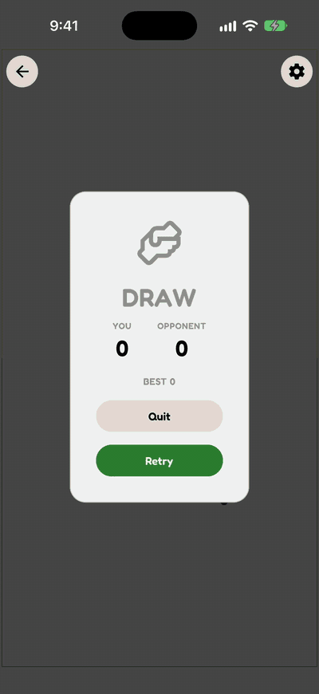

# Snake

Classic Snake, rebuilt for one shared phone: solo, against a CPU, or head-to-head with a friend.

Snake is a mobile arcade game for iOS, Android, and web. Built with Expo, React Native, and React Native Skia. It is part of a family of games built on my open-source `@tastic` game-engine and `@rific` Expo utility packages. App Store and Google Play release in progress.

<p align="center"></p>

## Features

- **Three modes on one board:** Solo (classic, no rival), Vs CPU (Easy, Normal, or Hard), and 2 Player, with both snakes steered at the same time from split-screen touch zones on one device.
- **Round settings:** Wrap Edges (leave one side, come back on the other), three speeds, three grid sizes, and a full-screen board option.
- **Arenas:** Open, Pillars, Gauntlet, Portals (paired teleport cells), and Underpass (a corridor where snakes pass through each other's bodies without a crash).
- **Six optional powerups,** off by default: Sidewind (speed boost), Scales (one-hit shield), and four that hit the opponent: Coldblood (freeze), Constrict (cut its body in half), Mesmerize (reversed controls), and Frenzy (forced speed).
- **Profiles, stats, and achievements:** saved player profiles (name, color, tag) picked per seat, per-seat and per-mode stats, and tiered bronze/silver/gold achievements, including beating each CPU difficulty.
- **Retro sound and haptics:** chiptune game sound effects and UI click/pop sounds, with sound and haptics toggles.
- **How-to-play guide** on first launch, replayable from Settings, with text that matches the current device (swipe on touch; mouse or WASD/arrows/IJKL/numpad on desktop).
- **Lock Orientation** setting, plus an automatic pause when the app goes to the background mid-match.

## Under the hood

- **Pure, tick-based engine.** `src/utils/snakeEngine.ts` is a side-effect-free reducer (`createInitialSnakeState`, `tickSnake`, `applySnakeTurnIntent`, `applySnakePowerupActivation`) with injectable randomness. `useSnakeState` drives it from a `requestAnimationFrame` loop at a fixed per-speed interval (150 / 110 / 80 ms). Speed powerups run as sub-steps inside one tick, so head-on collisions, shields, and body cuts resolve the same way at any speed.
- **Turn buffering.** Input never mutates direction directly: swipes and keys resolve to a direction (`src/utils/turnIntent.ts`, `keyboardControls.ts`) and are stored as a `pendingDirection` that the next tick commits. Reversing into your own neck and repeated no-op turns are dropped, and turn sounds and haptics fire only for turns that will actually happen.
- **CPU opponent.** `src/utils/snakeAi.ts` scores each candidate direction by the open space behind it, using a capped breadth-first flood fill (`floodFill.ts`) that understands wrap edges, portals, and tunnels. Close scores are broken toward food, then toward going straight. Difficulty changes how often the CPU takes its best move, not how fast it reacts. On Normal and Hard it also picks up and uses powerups, and it can correct for its own reversed controls while Mesmerized.
- **Skia rendering with a web split.** The board (`SnakeBoardCanvas.tsx`) is drawn with React Native Skia and Reanimated: snakes glide smoothly between ticks, and a dead snake fades tail to head over a time based on its length. `SnakeBoard.tsx` and `SnakeBoard.web.tsx` are platform files: on web the canvas module is loaded only after Skia's CanvasKit WebAssembly is ready.
- **Two players on one screen.** `TouchInputLayer` gives each seat its own gesture zone (top/bottom when facing each other, left/right side by side) using Gesture Handler pan and tap gestures, and the in-game overlays are rotated to face each seat. On web, `KeyboardInputLayer` maps each seat to its own key scheme, and when two seats choose the same scheme they swap.
- **State and persistence.** Redux Toolkit with redux-persist on AsyncStorage: settings, theme, sound, haptics, profiles, profile selection, seat colors, achievements, and guide progress are saved. A per-round `liveplay` slice is not saved, and it captures the round's settings when the match starts, so changing settings mid-match only affects the next match. Returning players are recognized when the persisted store is migrated, so they don't see the first-run guide again.
- **Shared profiles and OTA updates.** Profiles are shared with the other games through an iOS App Group (via `@tastic/profile`). Over-the-air updates use `expo-updates` with a fingerprint runtime version, through `@rific/updater`'s update dialog and its build/update scripts.
- **Tests.** 264 Jest tests in 24 suites (`src/__tests__/`), covering the engine (including shield/body-cut edge cases), the AI, arenas, stats attribution, achievements, background pause driven through a real AppState listener, Redux slices and persistence, and key components and routes.

## Built on

| Package | Used for |
| --- | --- |
| [`@tastic/core`](https://github.com/jayrdeaton/React-Native-Game-Core) | Orientation and rotation handling, the background-pause hook, content bounds, themed root background |
| [`@tastic/grid`](https://www.npmjs.com/package/@tastic/grid) | Cell math, bounds checks, wrapping, and grid sizing |
| [`@tastic/input`](https://www.npmjs.com/package/@tastic/input) | Swipe-to-direction resolution, keyboard schemes, reversed-control handling |
| [`@tastic/split-screen`](https://www.npmjs.com/package/@tastic/split-screen) | Two-player zone layout on the setup screen |
| [`@tastic/hud`](https://www.npmjs.com/package/@tastic/hud) | Player setup panels, dialogs, settings, stats screens, how-to-play guide |
| [`@tastic/profile`](https://www.npmjs.com/package/@tastic/profile) | Player profiles shared across games, per-seat selection, seat colors |
| [`@tastic/achievements`](https://www.npmjs.com/package/@tastic/achievements) | Achievement catalog evaluation and Redux-backed stats/unlocks |
| [`@tastic/sprites`](https://www.npmjs.com/package/@tastic/sprites) | Skia obstacle shapes on the board |
| [`@tastic/edge-guard`](https://www.npmjs.com/package/@tastic/edge-guard) | Keeps iOS edge system gestures from firing during play |
| [`@rific/core`](https://www.npmjs.com/package/@rific/core) | Settings slice factory and safe back navigation |
| [`@rific/auto-paper`](https://www.npmjs.com/package/@rific/auto-paper) | React Native Paper theming from a seed color, light/dark |
| [`@rific/feedback-press`](https://www.npmjs.com/package/@rific/feedback-press) | Haptic and sound feedback, gated audio pools |
| [`@rific/splash-gate`](https://www.npmjs.com/package/@rific/splash-gate) | Holds the splash screen until theme, fonts, and profiles are ready |
| [`@rific/toaster`](https://www.npmjs.com/package/@rific/toaster) | Toast notifications (achievement unlocks, update errors) |
| [`@rific/scroll-view`](https://www.npmjs.com/package/@rific/scroll-view) | Scroll-view settings provider and state |
| [`@rific/focus-chain`](https://www.npmjs.com/package/@rific/focus-chain) | Peer dependency of `@tastic/profile` (profile editing) |
| [`@rific/updater`](https://www.npmjs.com/package/@rific/updater) | OTA update dialog and the `build`/`update` scripts |

## Getting started

```bash
npm install
npm run ios        # or: npm run android / npm start (web)
```

`npm run ios` and `npm run android` create a native dev build (`expo run:*`). The app needs a development client, not Expo Go, because it includes custom native code (the `@tastic/profile` App Group module and the `@tastic/core` / `@tastic/edge-guard` config plugins). Once a dev build is installed, `npm run client` starts Metro for it, `npm start` starts the Expo dev server (press `w` for web), and `npm run reset` starts with a cleared cache.

### Checks

```bash
npm run verify     # lint + jest + tsc
```

`verify` runs `npm run lint` (`expo lint`), `npm test` (Jest), and `npm run typecheck` (`tsc`). CI runs the same command, and `npm run build` / `npm run update` (via `@rific/updater`) run it before building or publishing.

## Project layout

```
src/
  app/          expo-router screens: home, loadout (player setup), game, profiles, achievements
  components/   Skia board, touch and keyboard input layers, dialogs, countdown, providers
  constants/    tuning (speeds, cell sizes, powerups), achievement catalog, guide steps
  hooks/        game-state loop, sounds, settings, stats, profiles
  redux/        store, persistence config, slices
  types/        shared TypeScript types
  utils/        engine, CPU AI, flood fill, arenas, spawn points, input resolution, stats
  __tests__/    Jest suites
  __mocks__/    manual mocks for native/Expo modules
```

## License

The code is released under the MIT License, see [LICENSE](LICENSE).

The game's name, logo, and icons, and the original artwork and audio in this repository, are not covered by that license and remain all rights reserved. If you fork it, please give your version its own name and look.
